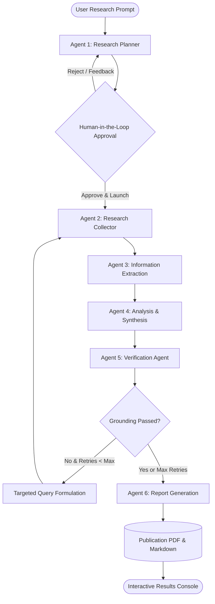
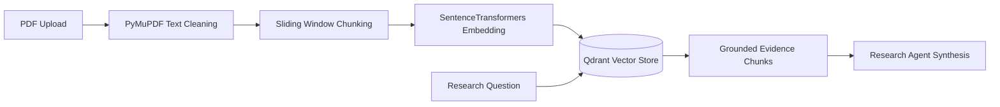

# NEXUS AI

### Autonomous Multi-Agent Research & Intelligence Platform

[](https://github.com/nexus-ai/nexus-ai/actions/workflows/ci.yml)
[](https://fastapi.tiangolo.com)
[](https://github.com/langchain-ai/langgraph)
[](https://react.dev)
[](https://www.typescriptlang.org)
[](https://tailwindcss.com)
[](https://opensource.org/licenses/MIT)

NEXUS AI is a production-oriented, autonomous multi-agent intelligence platform designed to conduct rigorous scientific and technical research. Rather than generating superficial chatbot responses or linear prompt chains, NEXUS AI deploys an orchestrated swarm of six specialized agents within a cyclic LangGraph state machine. The system autonomously formulates research plans, searches across academic registries (arXiv, Semantic Scholar, Crossref) and web sources, isolates atomic facts and empirical statistics, and enforces a strict citation verification feedback loop before compiling 12-section publication reports and downloadable PDFs.

---

## 1. Problem Statement

Modern generative AI models frequently suffer from:
1. **Hallucinated Citations & Fabricated Facts**: Generating non-existent DOIs, authors, or misattributed empirical statistics.
2. **Context Dilution in Complex Inquiries**: Single-prompt LLM interactions fail when tasked with multi-faceted comparative surveys across literature.
3. **Lack of Self-Correction**: Linear chains cannot backtrack when evidence fails to support analytical assertions.
4. **Disconnection from Local Documents**: Traditional web search engines cannot combine internal proprietary PDFs with real-time academic literature.

## 2. Project Objectives

- Provide genuinely autonomous, multi-agent research decomposition for complex scientific and engineering questions.
- Enforce strict citation verification with cyclic feedback retries when claims lack direct textual evidence.
- Integrate multi-registry academic search (arXiv, Semantic Scholar, Crossref) with live web search (Tavily) and local document RAG (PyMuPDF + Qdrant).
- Enable human-in-the-loop governance to inspect and edit research plans before expensive tool executions.
- Generate downloadable, publication-grade 12-section research reports in both Markdown and ReportLab PDF formats.

---

## 3. Technology Stack

### Backend & AI
- **Python 3.11+ / 3.12**
- **FastAPI**: Asynchronous REST gateway and WebSocket server
- **LangGraph**: Cyclic state graph orchestration and typed state persistence
- **OpenAI Python SDK**: Structured outputs and tool invocations
- **SQLAlchemy 2.0 (Async) & Alembic**: Normalized relational persistence and migrations
- **PyMuPDF (`fitz`)**: Fast, accurate PDF document text extraction and cleaning
- **Sentence-Transformers & Qdrant**: 384-dimensional dense semantic vector retrieval
- **ReportLab**: High-fidelity publication PDF generator

### Research & Literature Tools
- **arXiv API**: Automated Atom XML query parser for peer-reviewed preprints
- **Semantic Scholar Graph API**: Academic citation metadata and paper abstracts
- **Crossref Works API**: DOI resolution and scholarly publication indexation
- **Tavily Search API**: Search engine tailored for LLM research agents

### Frontend & UI
- **React 19 & TypeScript**
- **Vite**: Bundling and development environment
- **Tailwind CSS**: Dark-first, professional SaaS design system
- **@xyflow/react (React Flow)**: Interactive multi-agent workflow visualizer
- **Lucide React**: Vector iconography

---

## 4. Multi-Agent Architecture

NEXUS AI coordinates six specialized autonomous agents:



### Agent Responsibilities
1. **Research Planner Agent**: Deconstructs questions into prioritized subtasks, determines complexity, and outputs targeted academic search queries.
2. **Research Agent**: Queries arXiv, Semantic Scholar, Crossref, Tavily, and RAG vectors; deduplicates and ranks sources by empirical reliability.
3. **Information Extraction Agent**: Normalizes atomic facts, numerical statistics, methodologies, and concepts with explicit source indices and confidence scores.
4. **Analysis Agent**: Synthesizes cross-source patterns, comparative strengths/weaknesses, contradictions, and evidence-supported research gaps.
5. **Verification Agent**: Audits every analytical claim against source text. If unsupported, routes back to the Research Agent with targeted sub-queries.
6. **Report Generation Agent**: Formulates a complete 12-section research report, maps references, and builds publication-quality PDFs.

---

## 5. RAG & Document Intelligence Pipeline



- **Clean Document Normalization**: Hyphenated linebreaks, layout artifacts, and whitespace are cleaned automatically.
- **Chunk Attribution**: Chunks retain document ID, original filename, page number, and chunk index for precise source citation.
- **Resilient Fallback**: Operates with remote Qdrant instances (`http://localhost:6333`) or seamlessly falls back to embedded in-memory vector storage when Docker is offline.

---

## 6. Project Structure

```
nexus-ai/
├── frontend/                     # React 19 + TypeScript + Tailwind UI
│   ├── src/
│   │   ├── components/           # AgentFlow (React Flow), MetricCard, StatusBadge, Navbar, Sidebar
│   │   ├── pages/                # Landing, Dashboard, NewResearch, Monitor, Results, Reports, Docs, Settings
│   │   ├── layouts/              # MainLayout, AuthLayout
│   │   ├── services/             # Axios API client, WebSocket client
│   │   ├── types/                # TypeScript interfaces
│   │   └── App.tsx               # Master router
│   ├── package.json
│   └── vite.config.ts
│
├── backend/                      # FastAPI & LangGraph backend
│   ├── app/
│   │   ├── api/                  # Auth, Research, Agents, Documents, RAG, Reports, Analytics, WebSockets
│   │   ├── agents/               # Planner, Research, Extraction, Analysis, Verification, Report
│   │   ├── graph/                # LangGraph state machine, typed state, conditional edges
│   │   ├── rag/                  # PyMuPDF extractor, chunker, embeddings, Qdrant client
│   │   ├── tools/                # Tavily search, arXiv, Semantic Scholar, Crossref, CitationChecker
│   │   ├── database/             # SQLAlchemy async engine, sessionmaker, base models
│   │   ├── models/               # User, ResearchProject, Plan, Sources, Findings, Verification, Report
│   │   ├── schemas/              # Pydantic v2 schemas
│   │   ├── services/             # AuthService, ResearchService, DocumentService, ReportService, PDFGenerator
│   │   └── core/                 # Config, security (bcrypt & JWT), exceptions
│   ├── alembic/                  # Database migration revisions
│   ├── main.py                   # Application entrypoint & static SPA mounting
│   └── requirements.txt
│
├── tests/
│   ├── unit/                     # test_security.py, test_citation_checker.py, test_agents.py
│   └── integration/              # test_api.py, test_rag.py
│
├── docs/                         # System architecture, agent workflow, API reference, DB schema
├── scripts/                      # seed_demo.py
├── .github/workflows/ci.yml      # GitHub Actions CI pipeline
├── docker-compose.yml            # Multi-container orchestration (App, Postgres, Qdrant, Redis)
├── Dockerfile                    # Multi-stage production container build
├── .env.example                  # Environment configuration template
└── README.md
```

---

## 7. Getting Started

### Prerequisites
- Python 3.11+
- Node.js 18+ (tested on Node 20 / 24)
- Git

### Quick Setup

1. **Clone the repository**:
   ```bash
   git clone https://github.com/nexus-ai/nexus-ai.git
   cd nexus-ai
   ```

2. **Configure Environment Variables**:
   ```bash
   cp .env.example .env
   ```
   *(By default, SQLite and embedded Qdrant are enabled, allowing the application to run immediately without external credentials).*

3. **Install Backend Dependencies**:
   ```bash
   pip install -r backend/requirements.txt greenlet python-multipart pydantic-settings
   ```

4. **Install Frontend Dependencies & Build**:
   ```bash
   cd frontend
   npm install
   node node_modules/vite/bin/vite.js build .
   cd ..
   ```

5. **Seed Demo Research Project**:
   ```bash
   python scripts/seed_demo.py
   ```

6. **Start the Application**:
   ```bash
   cd backend
   uvicorn main:app --host 0.0.0.0 --port 8000 --reload
   ```

Open your browser at **`http://localhost:8000`** to access the complete application!
- **Interactive API Documentation**: `http://localhost:8000/docs`
- **Default Demo Credentials**: `demo@nexus-ai.org` / `nexus_password_123`

---

## 8. Docker Deployment

Deploy the entire stack (FastAPI Backend, React Frontend, PostgreSQL, Qdrant, and Redis) using Docker Compose:

```bash
docker-compose up --build -d
```

Services will be accessible at:
- **NEXUS AI Application**: `http://localhost:8000`
- **Qdrant Vector Console**: `http://localhost:6333/dashboard`
- **PostgreSQL Database**: `localhost:5432`

---

## 9. Running Tests

The test suite covers unit tests, agent pipelines, citation grounding, RAG retrieval, and FastAPI endpoints:

```bash
# Run all tests
python -m pytest tests/ -v

# Run unit tests only
python -m pytest tests/unit/ -v

# Run integration tests (API & RAG)
python -m pytest tests/integration/ -v
```

All 15 tests pass out of the box with zero external server dependencies:
```
tests/integration/test_api.py::test_health_check PASSED
tests/integration/test_api.py::test_auth_register_and_login PASSED
tests/integration/test_api.py::test_research_lifecycle PASSED
tests/integration/test_api.py::test_analytics_endpoints PASSED
tests/integration/test_rag.py::test_document_chunker PASSED
tests/integration/test_rag.py::test_embedding_service PASSED
tests/integration/test_rag.py::test_vector_store_indexing_and_search PASSED
tests/unit/test_agents.py::test_planner_agent PASSED
tests/unit/test_agents.py::test_extraction_and_analysis_agents PASSED
tests/unit/test_agents.py::test_report_generation_agent PASSED
tests/unit/test_citation_checker.py::test_verified_claim PASSED
tests/unit/test_citation_checker.py::test_unsupported_claim PASSED
tests/unit/test_security.py::test_password_hashing PASSED
tests/unit/test_security.py::test_jwt_token_creation_and_decoding PASSED
tests/unit/test_security.py::test_jwt_invalid_token PASSED
============================= 15 passed in 14.35s =============================
```

---

## 10. Known Limitations & Roadmap

- **External API Rate Limits**: Public arXiv and Semantic Scholar APIs may throttle rapid burst queries without an API key. A politeness delay is implemented.
- **Future Improvements**:
  - Support for multi-modal diagrams and chart extraction from PDF figures.
  - Integration with LaTeX rendering pipelines for mathematical formula validation.
  - Multi-tenant enterprise organization quotas and team workspaces.

---

## 11. License

This project is licensed under the MIT License - see the [LICENSE](LICENSE) file for details.

