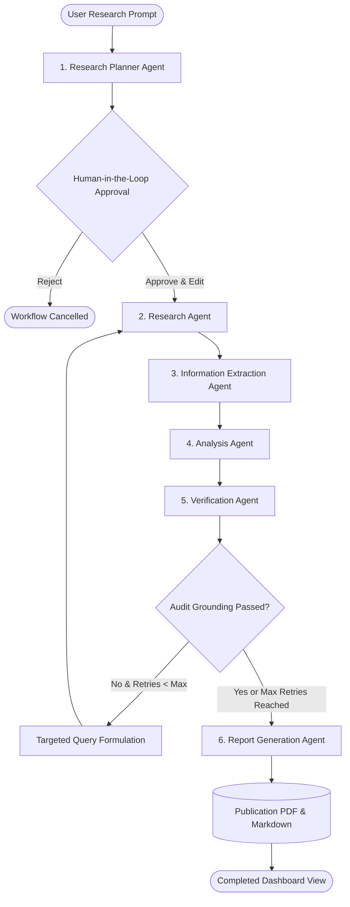

# Multi-Agent Workflow Specification

## 1. Multi-Agent Lifecycle & Decision Flow

The NEXUS AI multi-agent workflow operates as a state machine orchestrated through LangGraph:

## 2. Specialized Agent Roles

### Agent 1: Research Planner Agent
- **Input**: User prompt, research mode (`quick`, `deep`, `academic`), analysis depth (`standard`, `exhaustive`), target source count.
- **Cognitive Responsibilities**: Classifies domain, complexity, breaks inquiry into prioritized subtasks, and outputs targeted academic & web search queries.
- **Output**: `ResearchPlan` dictionary containing objectives, subtasks, queries, and expected evidence.

### Agent 2: Research Agent
- **Input**: Research queries, uploaded document IDs, unsupported claims (on retry).
- **Tooling**: Tavily Search API, arXiv API (Atom XML), Semantic Scholar Graph API, Crossref Works API, and Qdrant Vector Store.
- **Responsibilities**: Deduplicates papers across registries, computes relevance and reliability scores, and assigns 1-based source indices.

### Agent 3: Information Extraction Agent
- **Input**: Deduplicated sources.
- **Responsibilities**: Extracts atomic facts, empirical statistics, methodologies, and technical concepts. Every finding must explicitly record its source index, evidence quote, and confidence score.

### Agent 4: Analysis Agent
- **Input**: Extracted findings.
- **Responsibilities**: Synthesizes cross-source patterns, comparative strengths/weaknesses, contradictions, and evidence-grounded research gaps.

### Agent 5: Verification Agent
- **Input**: Extracted findings, analysis claims, source collection.
- **Verification Rule**: Claims are verified against source texts for semantic overlap and numerical accuracy.
- **Feedback Loop**: When unsupported claims occur and retries remain, state is flagged and routed back to the Research Agent for targeted retrieval.

### Agent 6: Report Generation Agent
- **Output Structure**: 12 standardized publication sections:
  1. Executive Summary
  2. Introduction
  3. Research Objectives
  4. Research Methodology
  5. Related Research & Literature Survey
  6. Empirical Findings & Extracted Evidence
  7. Comparative Analysis & Emerging Trends
  8. Technical Insights & Architecture
  9. Current System Limitations
  10. Identified Research Gaps & Future Trajectories
  11. Conclusion & Recommendations
  12. References & Source Citations
- **Deliverables**: Formatted GitHub Markdown and ReportLab publication PDF.

