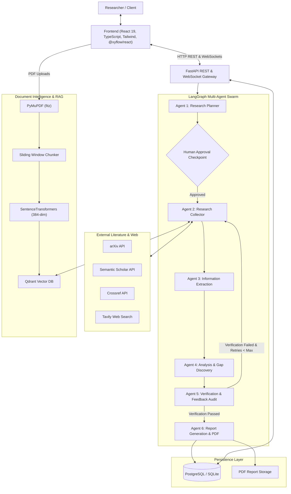

# NEXUS AI: System Architecture

## 1. Architectural Overview

NEXUS AI is built as a modular, decoupled, enterprise-grade multi-agent research intelligence platform. The architecture separates concerns across the **Client Layer** (React 19 + TypeScript + Tailwind CSS), **API & Coordination Layer** (FastAPI + Asynchronous WebSockets), **Multi-Agent Orchestration Layer** (LangGraph cyclic state graph with 6 specialized agents), **Document Intelligence & RAG Pipeline** (PyMuPDF, SentenceTransformers, and Qdrant), and **Persistence Layer** (PostgreSQL with SQLAlchemy 2.0 async / SQLite fallback).

## 2. Core Subsystems

### 2.1 Backend Gateway (FastAPI)
- **Asynchronous Execution**: Powered by `asyncio` and `uvicorn`, handling concurrent agent executions and bi-directional WebSockets without blocking thread pools.
- **Strict Data Validation**: Pydantic v2 schemas across all payloads.
- **Security & RBAC**: JWT Bearer authentication with direct bcrypt hashing (no deprecated passlib wrappers).

### 2.2 LangGraph Multi-Agent Engine
- **Shared Graph State**: Typed state dictionary (`ResearchGraphState`) passed through every agent node.
- **Human-in-the-Loop Checkpoint**: Research execution is halted after the Planner Agent creates the structured plan, allowing the human operator to approve, edit subtasks, or inject domain constraints.
- **Citation Verification Loop**: Claims extracted from sources are audited by the Verification Agent using semantic and keyword grounding. If claims fail threshold confidence, a conditional edge re-routes the workflow back to the Research Agent with targeted sub-queries.

### 2.3 Document Intelligence & RAG
- **PDF Extraction**: Extracts page-level text, table-of-contents, and metadata using PyMuPDF (`fitz`).
- **Semantic Vector Storage**: Supports Qdrant both via remote connection (`http://localhost:6333`) and embedded in-memory fallback (`QdrantClient(":memory:")`), guaranteeing zero runtime crashes when Docker is offline.

